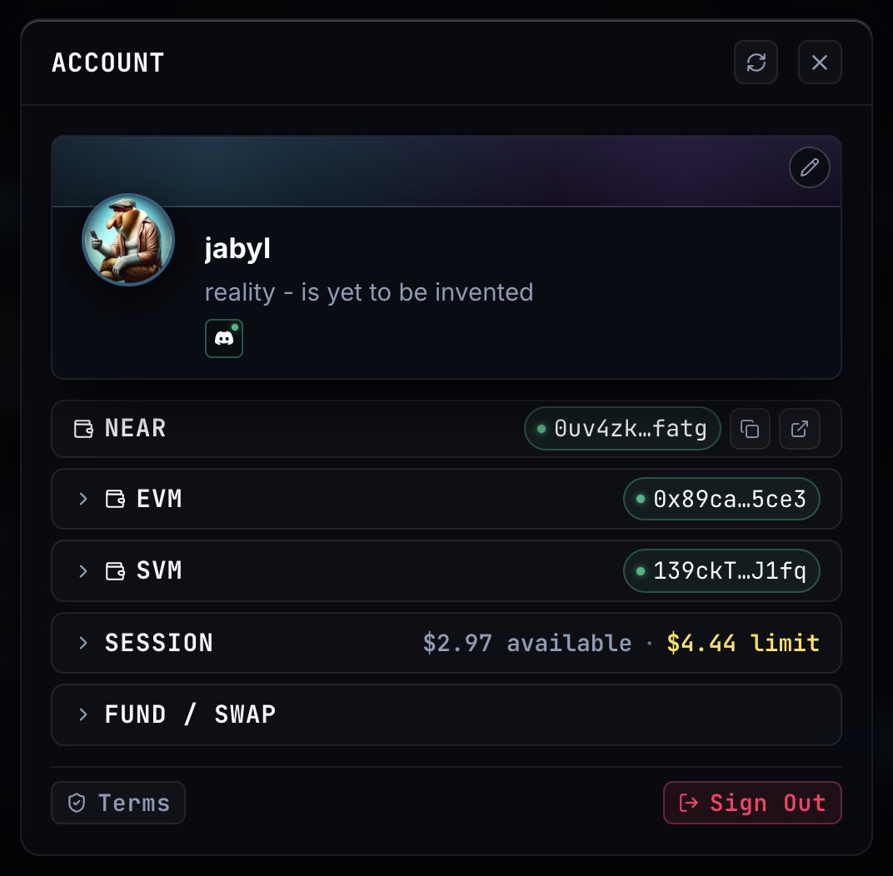

Open [Man0](https://app.man0.space) and choose a sign-in method. You can use a passkey, an email code, or one of the account providers shown in the dialog.

For a passkey, follow your browser’s sign-in prompt. An email code expires after five minutes. Review the terms and privacy checks to finish setting up your account.

## Open your account

Click your name and balance in the top-right corner. The **Account** dialog contains your profile, NEAR address, connected EVM and Solana wallets, **Session**, and **Fund / Swap**.

Click the pencil on your profile card to change your name, bio, avatar or banner. You can upload an image or generate one from your description. Add the social accounts you want people to find on your creator profile.

Your NEAR address belongs to your Man0 account. Use the copy button to copy it or the explorer button to view it. Expand **EVM** or **SVM** to connect a wallet from your browser.

See [Session](/app/session) to approve workflow spending, or [Fund / Swap](/app/fund-swap) to move funds between supported networks.
