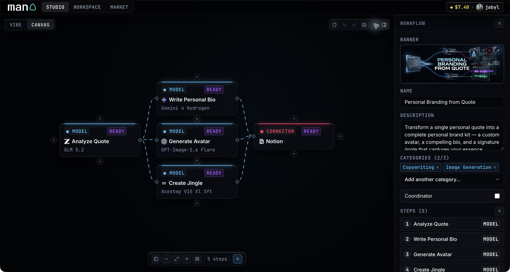
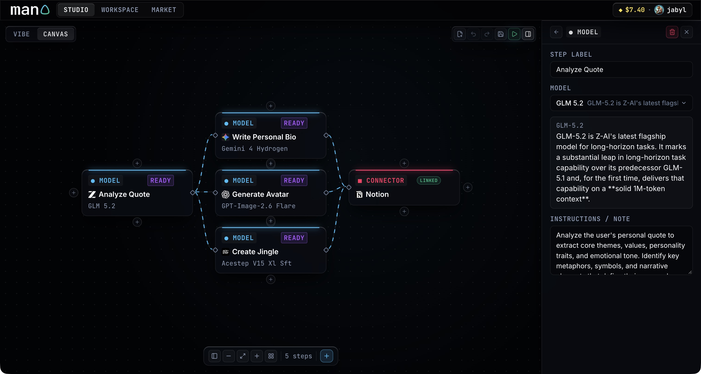

Open **Studio → Canvas** to build or edit the workflow visually. Drag steps into place and connect them to pass earlier results to the next step.

## Add and connect steps

Open **Catalog** with the plus button, or press **⌘/Ctrl + N**. Choose a model, connector or agent. Use a step’s directional plus controls to insert another step beside it; you can also wire steps together by dragging between their connection handles.

Drag a step to move it. A branch can send the same analysis to several steps, while a later step can combine their outputs.

## Edit a step

Click a step to open its inspector. Change **Step label**, select its catalog entry, and write the task in **Instructions / Note**. Say what it should produce and how it should use the earlier output.

The delete button removes the selected step. **Back** and **Forth** undo and redo Canvas changes. Use the bottom controls to fit the graph, zoom or arrange it.

## Save the workflow

Open the workflow overview to edit its name, description, banner, categories and coordinator. Click **Save**, or press **⌘/Ctrl + S**, to put the draft in **Workspace**. Studio then starts a fresh Canvas.

| Shortcut | Action |
| --- | --- |
| ⌘/Ctrl + N | Open Catalog |
| ⌘/Ctrl + S | Save |
| ⌘/Ctrl + Z | Undo |
| ⌘/Ctrl + Shift + Z | Redo |

Try the graph with [Test run](/app/test-run) before publishing it.
