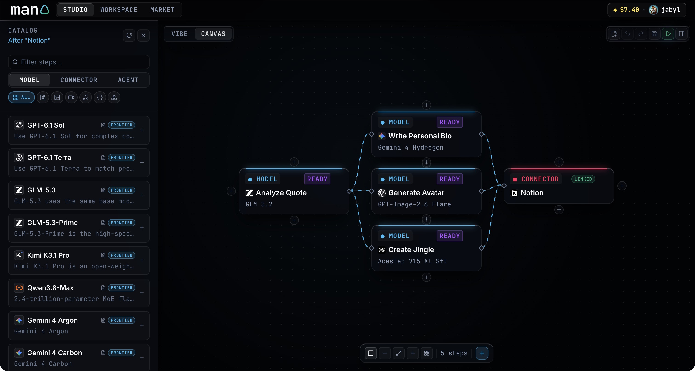
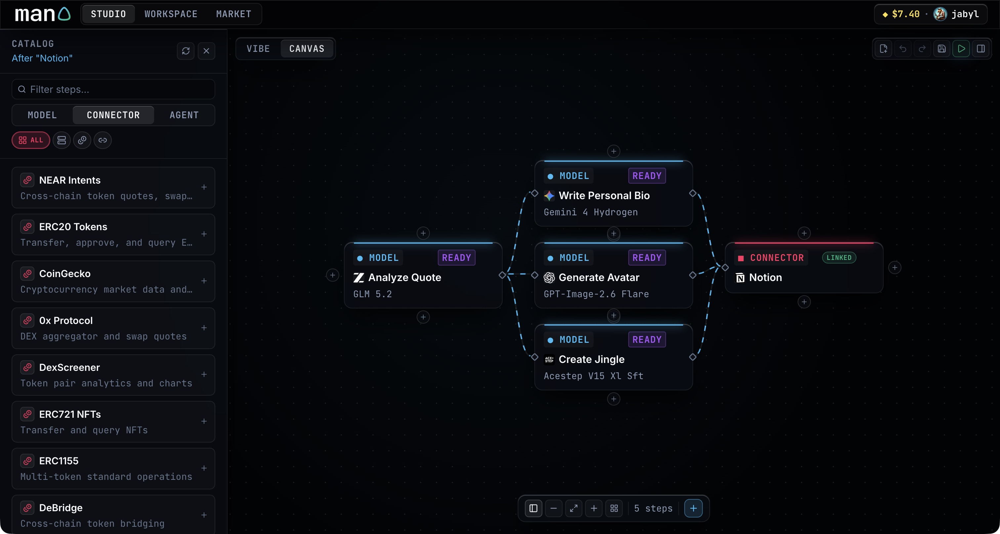

Open **Catalog** in Canvas and choose **Model**, **Connector** or **Agent**. Search by name or task, then use the category controls to narrow the list.

## Models

A model step transforms its input. Use text models for analysis and writing; choose an image, audio, music or video model when the step needs that kind of output.

Read the entry’s description and supported inputs before selecting it. The catalog includes model families and **Frontier** or **Latest** labels to help you compare entries.

## Connectors

Connectors read from services or deliver results to them. Choose the service, then describe the action in the step’s instructions. For example, ask Notion to create a page containing the earlier steps’ outputs.

Some connectors need an account connection or a credential. Man0 asks for it when the workflow needs access; you can then resume the same run.

## Agents

Use an agent step when you want a specialist to handle part of the workflow. A [coordinator](/app/coordinators) manages the whole run, while an agent step handles its assigned task.

The catalogs support external sources and will grow over time, opening to verified external contributors.
