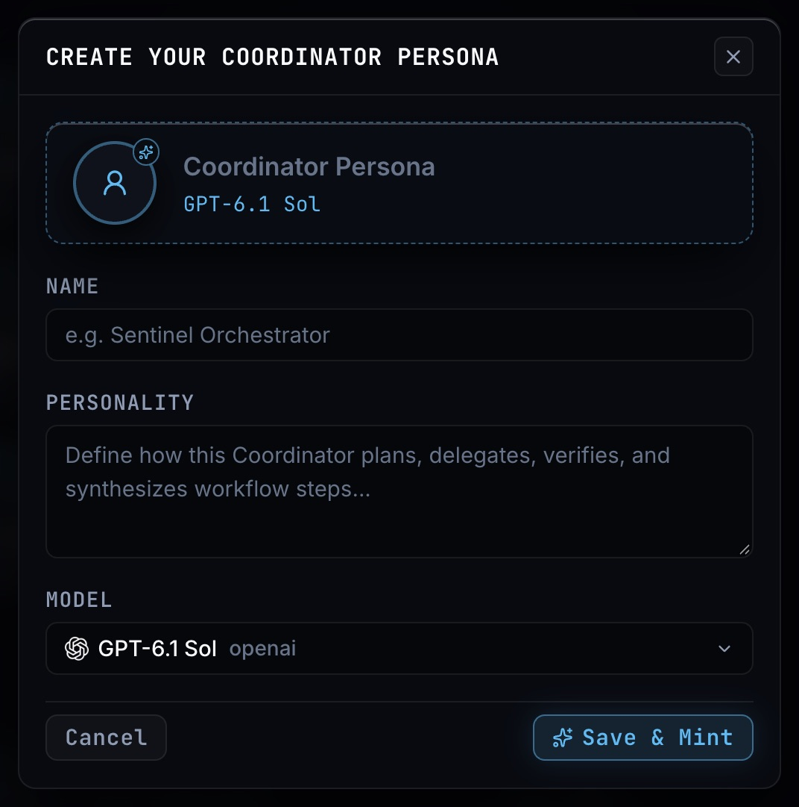

A coordinator manages the workflow: it follows the connections, calls the selected resources and combines their results. You can reuse a coordinator across workflows.

In the workflow overview, open **Coordinator** and choose an existing card. You can also change the coordinator in the test or run panel before starting.

## Create your own

Click the **Create Coordinator Persona** plus button beside the coordinator selector. Enter **Name** and **Personality**: the tone of its writing, the format of its output, or the checks it should make before delivering a result.

Select **Model**, then upload or generate an avatar. Review the card and click **Save & Mint** to record the persona on NEAR and make it available for reuse.

A coordinator’s personality applies to the whole run. Keep the instructions for individual jobs on their [Canvas steps](/app/canvas#edit-a-step).
