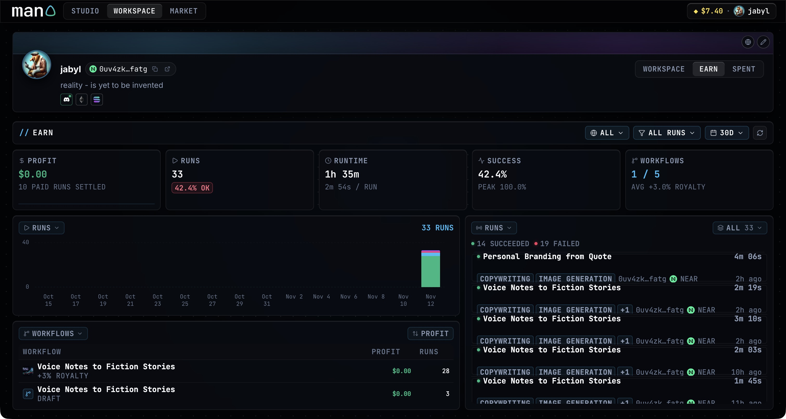
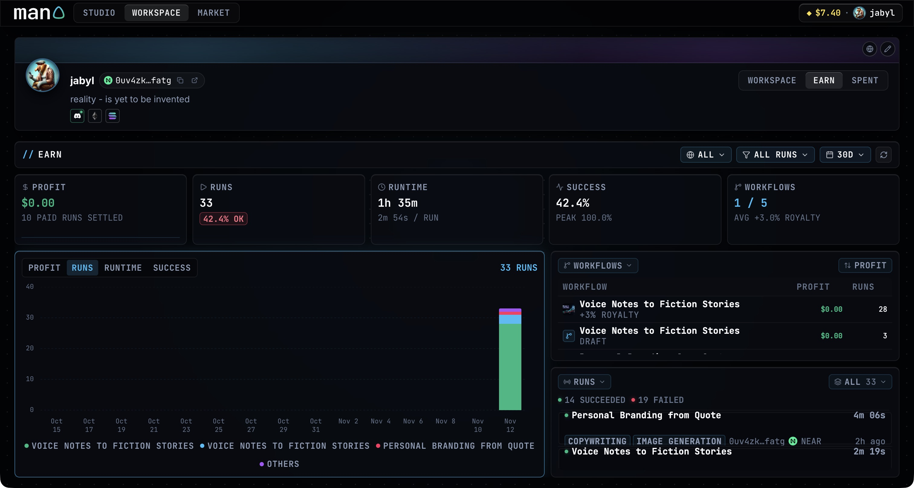
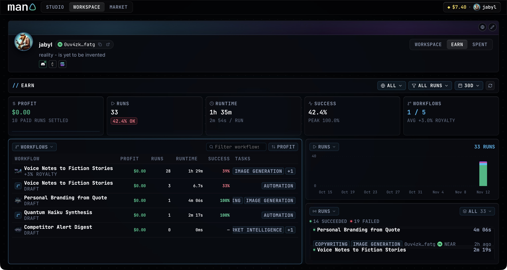

Open **Workspace → Earn**. The dashboard shows royalties and activity for your workflows, including drafts and published work.

## Choose what to compare

Select **24H**, **7D**, **30D** or **180D**. Filter by **NEAR**, **EVM** or **Solana**, and use **PAID** or **FREE / DRY** to narrow the activity. Click the refresh button to update the data.

| Metric | What it shows |
| --- | --- |
| **Profit** | Your creator royalties |
| **Runs** | Workflow executions, with paid-run counts |
| **Runtime** | Total execution time and average time per run |
| **Success** | The share of successful runs |
| **Workflows** | Published workflows and your total workflow count |

## Inspect a chart or workflow

Click a chart or table to expand it. Change the timeline to **PROFIT**, **RUNS**, **RUNTIME** or **SUCCESS**; hover over a point to see its values. Runs and runtime show the leading workflows alongside the remaining activity.

The **WORKFLOWS** table compares royalties, runs, runtime and success. Change its sort order, or expand it to search by workflow, task or network. Select a workflow row to open its details.

Switch to **BY TASK** to compare categories by profit, runs or runtime.

## Read the activity

Choose **RUNS** for execution history or **SETTLEMENTS** for payment records. Filter runs by **SUCCEEDED** or **FAILED**. Open transaction or proof links on the records that include them.

On smaller screens, use **Overview**, **Workflows** and **Activity** to move between the dashboard sections. [Payment and prices](/app/session#payment-and-prices) explains how each run calculates your creator fee.
