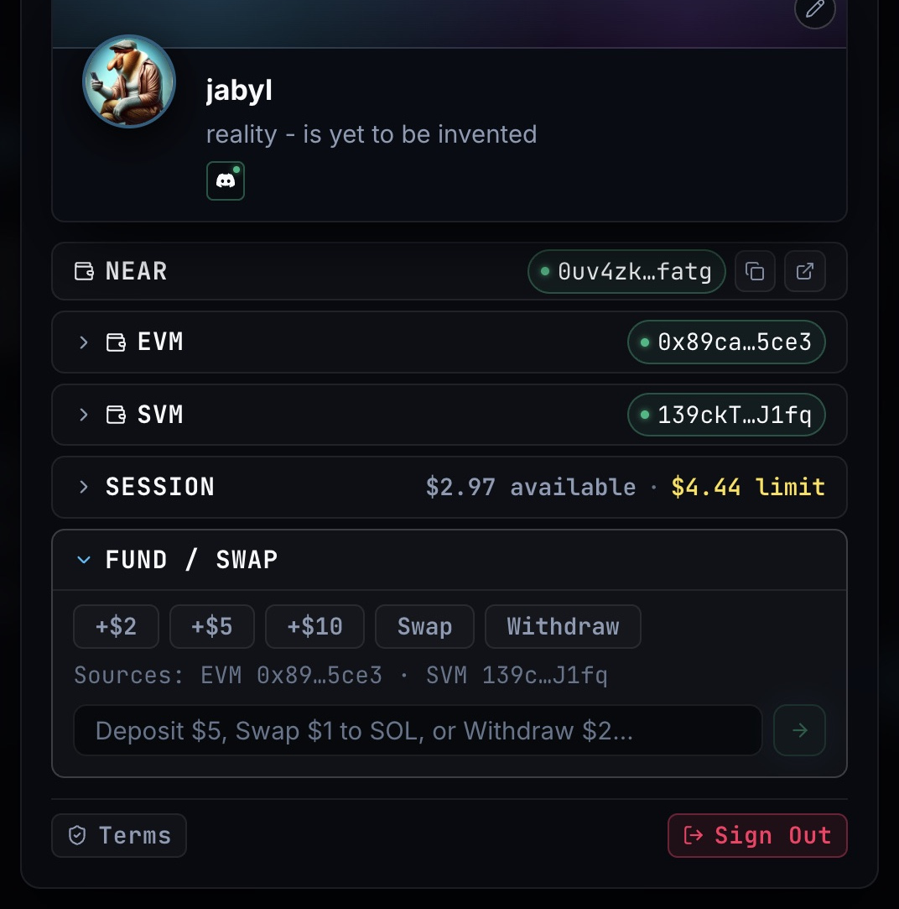

Open **Account → Fund / Swap**. Connect the EVM, Solana or NEAR wallet you want to use, then describe the transfer.

You can write “Deposit $5”, “Swap $1 to SOL”, or “Withdraw $2 to” followed by the destination address. The quick buttons fill a starting request for you.

<Steps>
  <Step title="Find the route">
    Enter the amount, token and destination you need, then click the arrow to find a route. Man0 reads the supported networks and available wallet balances.
  </Step>
  <Step title="Review the transfer">
    Check the source wallet, input amount, destination token, receiving address and quoted output. A transfer can use more than one funding source.
  </Step>
  <Step title="Confirm and follow progress">
    Continue with the route and confirm any request in your connected wallet. Follow **Route Ready**, **Origin Tx**, **Swap** and **Credited**; use the transaction links to inspect the transfer.
  </Step>
</Steps>

NEAR Intents handles the supported cross-chain route. Once deposited funds reach your account, open [Session](/app/session) to approve the amount you want workflows to spend.
