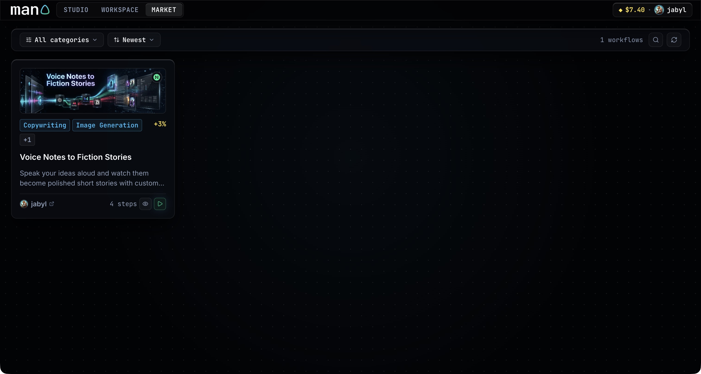
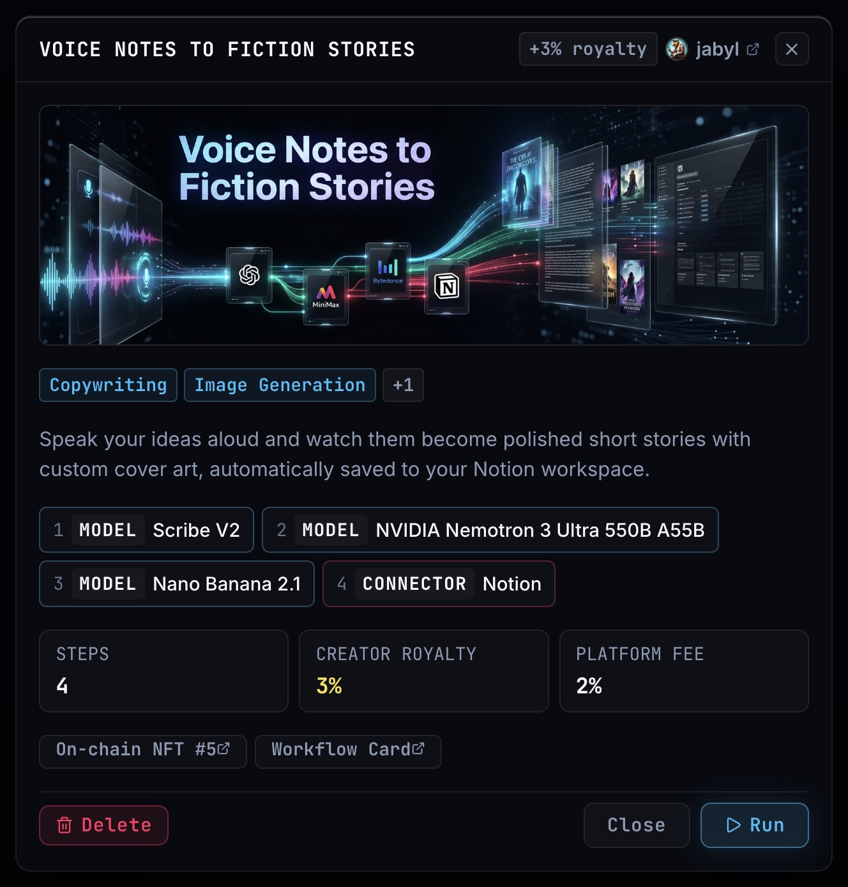

Open **Market** to find workflows published by creators. Search for a task, filter by category, and choose the sort order that helps you find what you need.

Open a workflow to read its description, see its steps and coordinator, and check its creator fee. The creator card links to their profile; ownership and metadata links let you inspect the published record.

Click **Run** when you’re ready to supply your own input. You’ll use your spending session for the run, and the results stay in your workflow conversation.

See [Run a workflow](/app/run) for files, recordings and connector requests. To list your own work here, [publish a saved draft](/app/publish).
