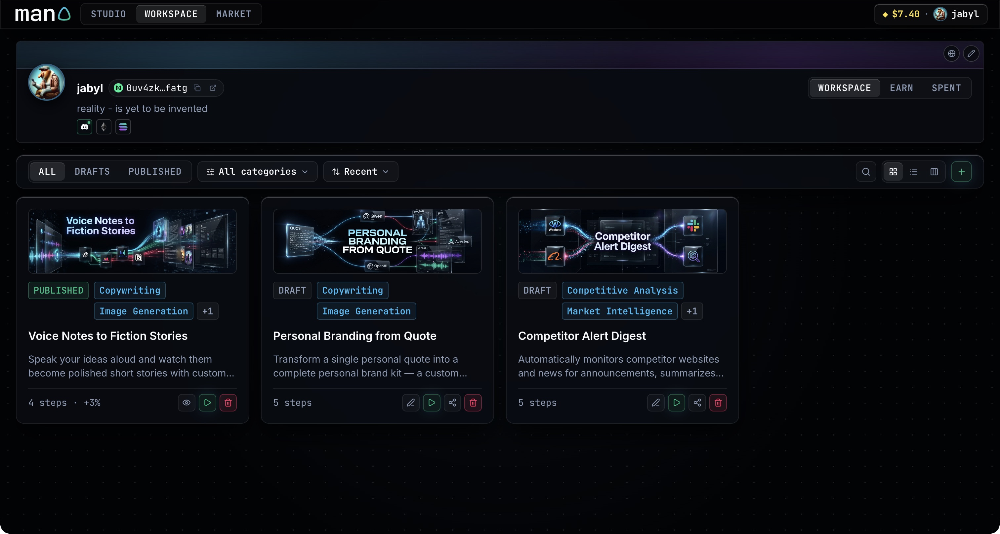

Man0 turns a task into a workflow you can reuse, built in a visual drag-and-drop canvas. Combine AI models with connected services and specialist agents: analyze a document, create an image, write a report, or send the result to an app you use.

You can describe the outcome in **Vibe**, or choose and connect each step in **Canvas**. Keep the workflow in **Workspace** for your own work, or publish it in **Market** and earn a creator fee when other people run it.

The catalogs currently include **4k+ connectors & accounts, 600+ models, and 100+ agents**.

<Columns cols={2}>
  <Card title="Build your first workflow" icon="sparkles" href="/app/vibe">
    Describe the task, then review the steps in Canvas.
  </Card>
  <Card title="Run a workflow" icon="play" href="/app/run">
    Supply text, files or a recording and follow the results.
  </Card>
  <Card title="Publish your work" icon="share-nodes" href="/app/publish">
    Set a creator fee and make your workflow available in Market.
  </Card>
  <Card title="Set a spending limit" icon="wallet" href="/app/session">
    Choose how much your workflow session can spend.
  </Card>
</Columns>

Building an integration? Start with the [developer guide](/developer/overview). The [NEAR section](/near/overview) explains accounts, Intents and ownership contracts.
