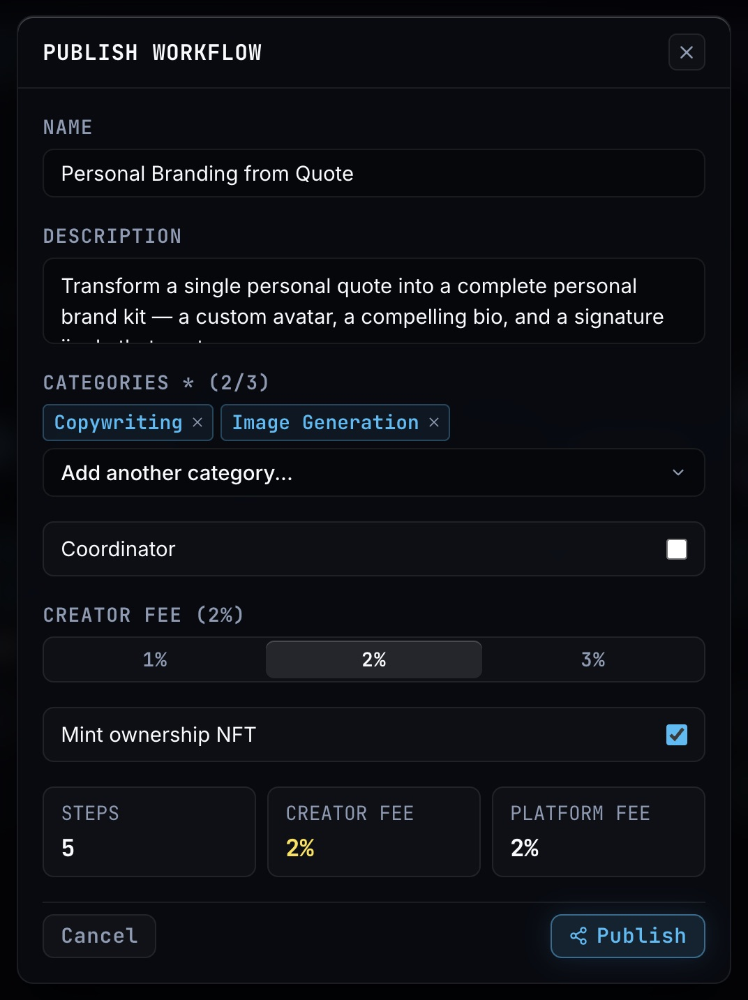

Save and test the workflow first. In **Workspace**, click **Publish** on its draft card.

<Steps>
  <Step title="Check the workflow details">
    Review **Name** and **Description**, then choose up to three **Categories** so people can find the workflow by task. Check the step count below.
  </Step>
  <Step title="Choose the coordinator and creator fee">
    Enable **Coordinator** if you want to attach a specific persona. Choose a **Creator fee** of **1%**, **2%** or **3%** for runs by other people.
  </Step>
  <Step title="Review ownership">
    **Mint ownership NFT** starts selected. Leave it selected to record the workflow’s ownership on NEAR and attach its metadata card.
  </Step>
  <Step title="Publish">
    Click **Publish**. The workflow appears in Market and in Workspace’s **Published** filter.
  </Step>
</Steps>

People who run your published workflow pay for its compute and the applicable service fees. See [Payment and prices](/app/session#payment-and-prices) for the breakdown, and [Earn](/app/earn) for your workflow’s activity.
