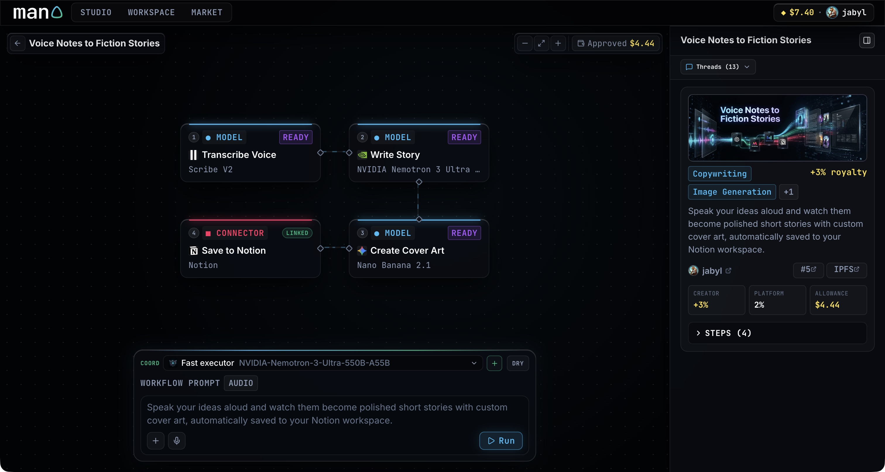
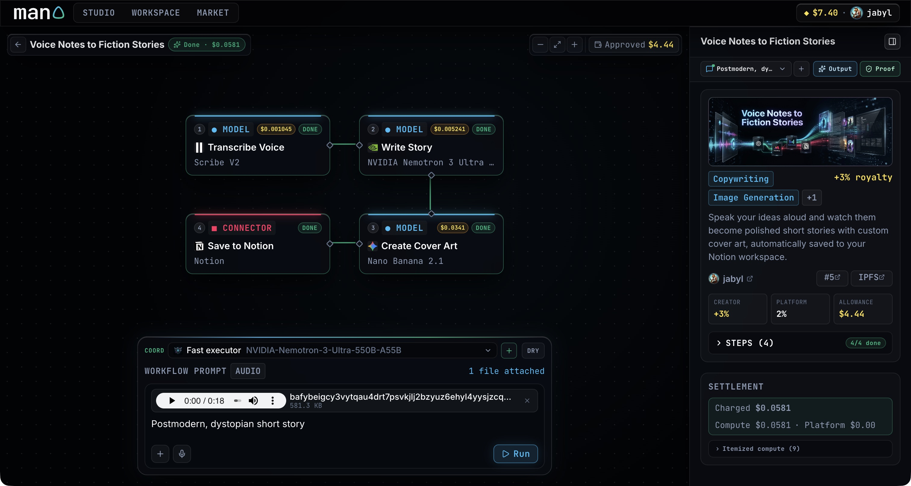
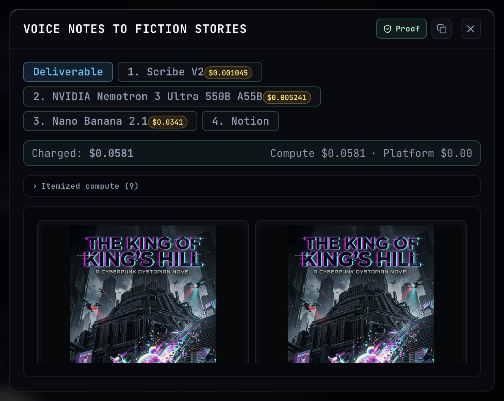
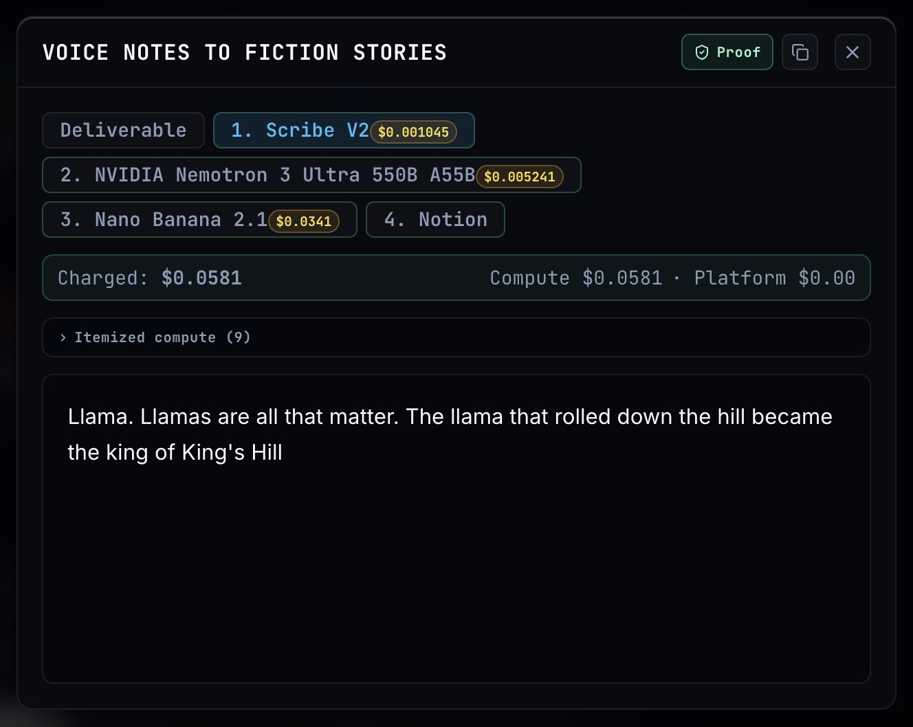
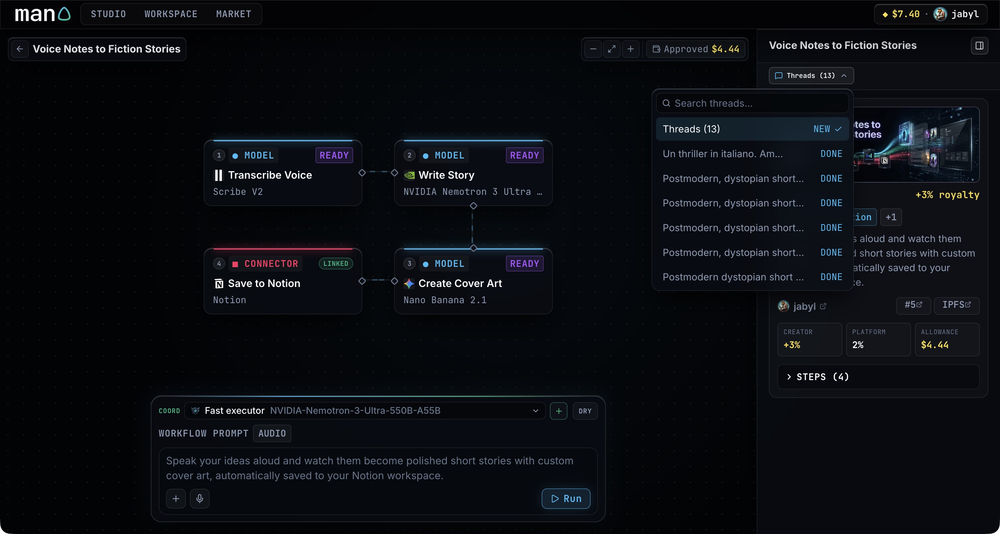

Open a workflow from **Workspace** or **Market** and click **Run**. The workflow page shows its description, steps and creator before you start.

## Give it the input it needs

Choose the coordinator and check your spending session. Type your request in the composer, attach files, paste or drop them into the input, or use the microphone to record a message.

You can send up to eight attachments, with a 20 MB limit per file. Preview or remove a recording before submitting. Press **Enter** to send, or **Shift + Enter** to add a line.

## Follow the run

The activity view shows what the coordinator is doing and which steps have finished. Open a step to read its output.

If a service needs a connection, open its request, connect the account and continue. If the workflow asks a question, answer it in the same conversation. Man0 keeps the completed step outputs with the thread.

## Use the result

Click **Output** beside the thread selector to open the result. **Deliverable** contains the combined output; the numbered tabs show each step’s result. Use **Copy output** for text, or open the generated media and delivery links.

<Tabs>
  <Tab title="Deliverable">
    
  </Tab>
  <Tab title="Step output">
    
  </Tab>
</Tabs>

Open **Itemized compute** to inspect the [payment breakdown](/app/session#payment-and-prices), or **Proof** for the execution record. The workflow panel also shows the settlement receipt.

## Reopen a saved run

Open **Threads** in the workflow card, search the conversations, and choose the one you want. You can read its results without starting another run. Use the plus button beside the selected thread to start a new conversation.

