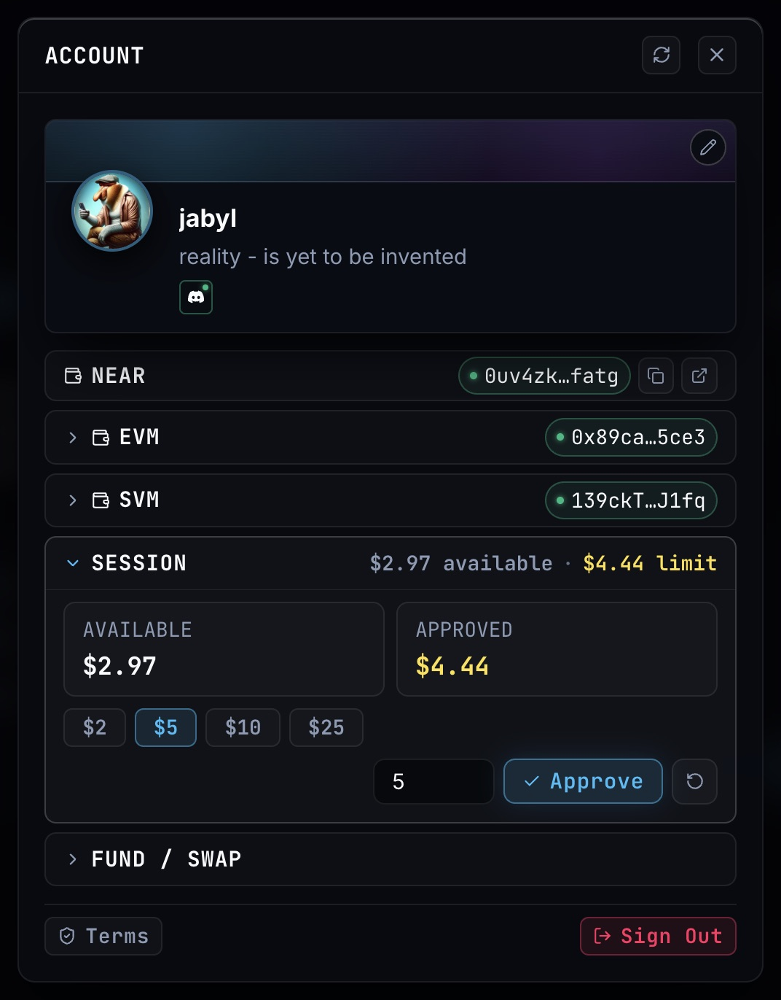

Open your account from the top-right corner, then expand **Session**. **Available** is the balance in your deposit wallet; **Approved** is the balance reserved for workflow spending.

Choose **$2**, **$5**, **$10** or **$25**, or enter an amount. Click **Approve** to move that amount into your spending wallet and activate the session.

The approved amount is a spending limit. A run charges for the work it performs; it doesn’t charge the whole limit just because you approved it. Use **Reclaim unused funds** to return the remaining spending balance to your deposit wallet.

Need more funds? Open [Fund / Swap](/app/fund-swap).

## Payment and prices

Run prices depend on the models, connector operations and agents the workflow uses. The result shows the compute bill and service fees separately.

| What you run | Charges |
| --- | --- |
| Your unpublished draft | Compute |
| Your own published workflow | Compute + 2% platform fee |
| Another creator’s published workflow | Compute + their 1–3% creator fee + 2% platform fee |

Fees use the compute bill as their base. For example, a **$0.10** compute bill with a **3%** creator fee and **2%** platform fee totals **$0.105**.

The runtime meters compute, while x402 settles the workflow’s service fees through the spending session. You can inspect the breakdown and receipt in the run result. A paused run can already have incurred compute charges for its completed work.
