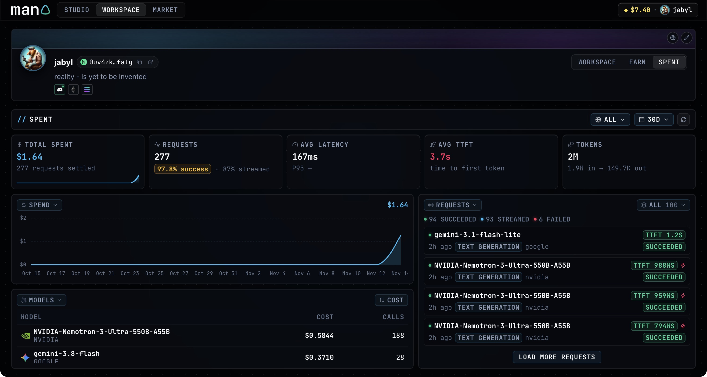
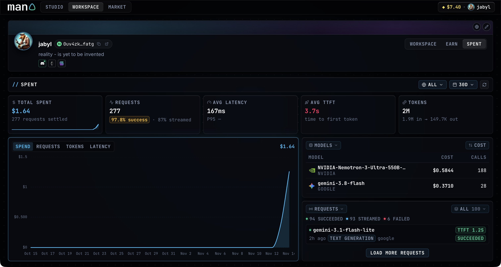
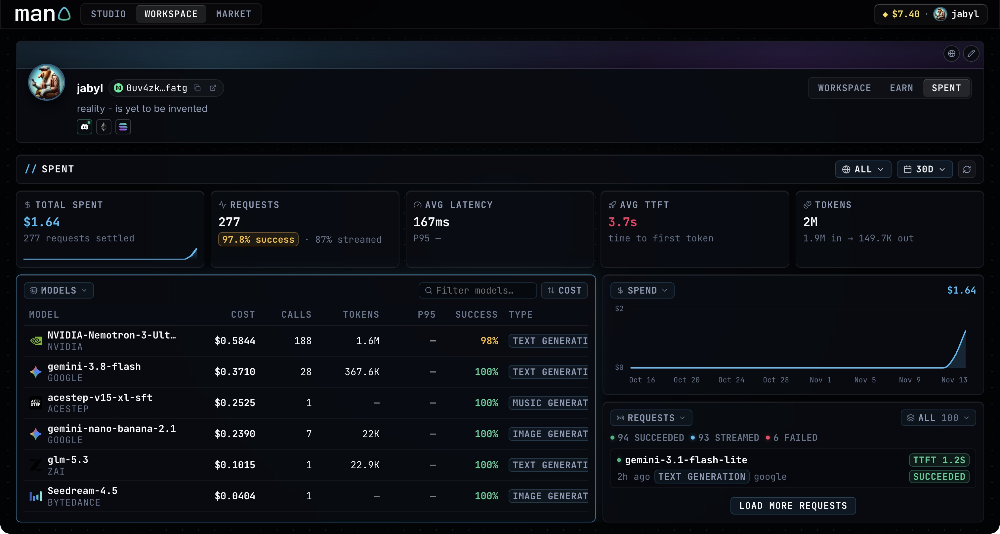
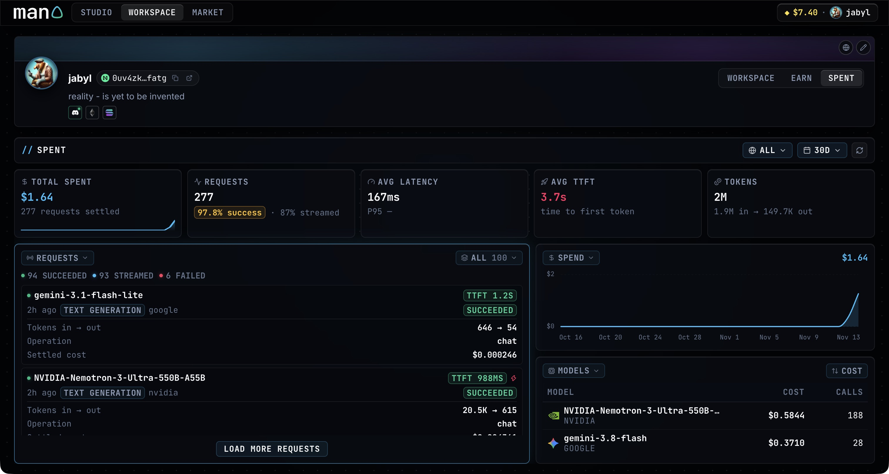
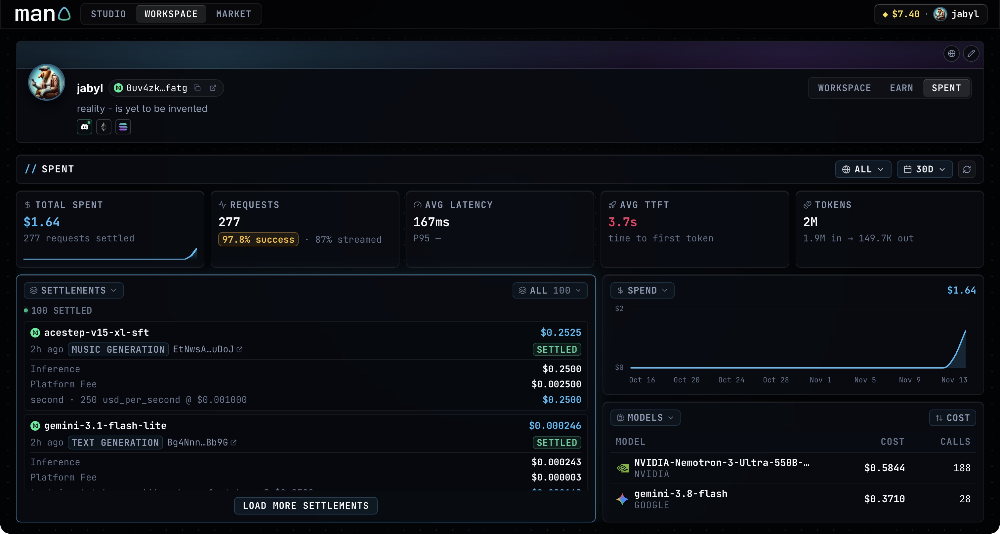

Open **Workspace → Spent** to see what your model requests cost and how they performed. Choose **24H**, **7D**, **30D** or **180D**, filter by network, and click refresh to update the data.

## Compare cost and performance

**Total Spent** shows settled spending. **Requests** includes the success rate and share of streamed responses; **Avg Latency** measures the full request, while **Avg TTFT** measures time to the first token. **Tokens** separates input and output.

Click the chart to expand it, then choose **SPEND**, **REQUESTS**, **TOKENS** or **LATENCY**. Hover over a point to read its values; the latency chart compares average, P50, P95 and P99 timings.

## Find the models behind the bill

Click the model table to expand it. Search by model or provider, and sort by **COST**, **CALLS**, **TOKENS**, **LATENCY**, **SUCCESS**, **RECENT** or **TYPE**. The **P95** column is the time within which 95% of requests finished.

Switch to **BY TYPE** to compare spending and usage across text, image, audio and other model types.

## Inspect requests and settlements

Expand the activity panel. **REQUESTS** shows individual calls and their status, timing, token counts, operation and settled cost. Use the status filter to narrow the list.

<Tabs>
  <Tab title="Requests">
    
  </Tab>
  <Tab title="Settlements">
    
  </Tab>
</Tabs>

Choose **SETTLEMENTS** for payment records, including the inference charge and platform fee. **Load more requests** and **Load more settlements** open older records; follow the transaction links where shown.

See [Session, payment and prices](/app/session) for spending approval and workflow fees, or [Earn](/app/earn) for your creator royalties.
