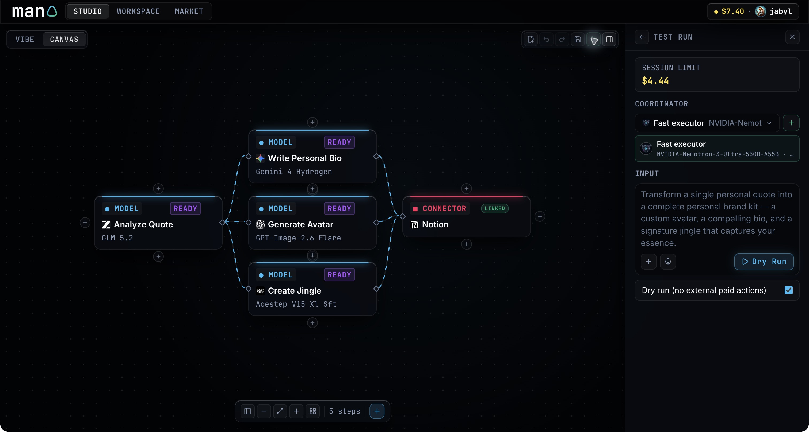

Click **Test run** in Studio’s top-right controls to open the test panel. You can test the graph while it’s still on Canvas.

<Steps>
  <Step title="Choose the session and coordinator">
    Check the spending limit and select the coordinator for this test. Use [Session](/app/session) if you need to approve funds.
  </Step>
  <Step title="Add your input">
    Type the task, attach a file, or record a voice message. Files can be up to 20 MB each. Preview a recording before sending it.
  </Step>
  <Step title="Choose how to test">
    **Dry run (no external paid actions)** starts selected. It tests without connector writes; models and read operations can still use paid compute. Clear it when you want the connector to carry out the action.
  </Step>
  <Step title="Review the outputs">
    Submit the input, follow the activity, then open the individual step outputs. If the workflow asks for information or a connection, supply it and continue the same thread.
  </Step>
</Steps>

Press **Enter** to submit or **Shift + Enter** for a new line. After the test, edit any unclear step instructions and [save the draft](/app/canvas#save-the-workflow).
