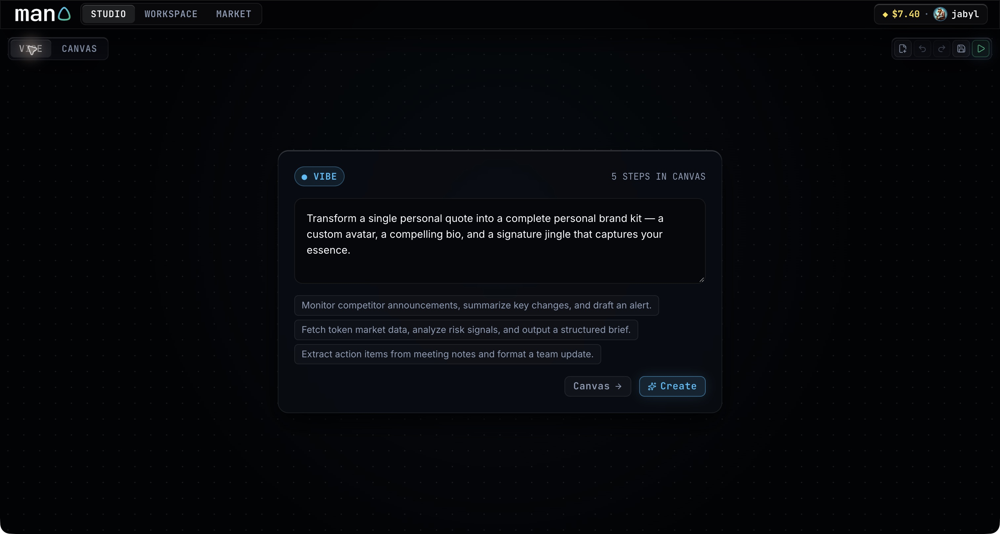

In **Studio → Vibe**, describe the job and where its result should go. Name any model or connected app you want to use.

For example: “Take a personal quote, write a short bio, generate an avatar and a jingle, then put the kit in Notion.”

<Steps>
  <Step title="Describe the outcome">
    Include the input, the work to do, and the final output. Choose an example prompt if you want a starting point.
  </Step>
  <Step title="Click Create">
    Man0 selects catalog entries and adds their steps and connections to Canvas. You can follow the progress as it builds.
  </Step>
  <Step title="Review the workflow">
    Open **Canvas**. Select each step to check its model or connector and edit its instructions. Use the workflow overview to check the title, description, categories and coordinator.
  </Step>
</Steps>

You can return to Vibe and describe a change to the current workflow. Ask for a specific edit, such as “replace the image step with a logo” or “send the report to Notion.”

Vibe builds the workflow; [Test run](/app/test-run) lets you try it with your own input. Files and voice recordings go in the test or run composer.
