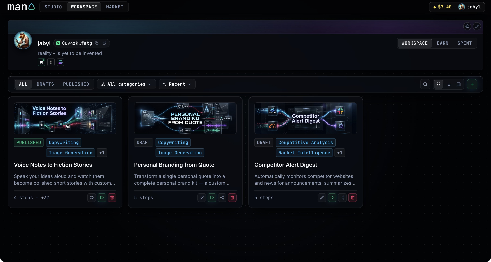

**Workspace** holds your saved drafts and published workflows. Use **All**, **Drafts** or **Published** to choose what you see.

Search by name, filter by category, or change the sort order. The view controls switch between **Cards**, **List** and **Columns**.

Each workflow shows its status, categories and step count. Use its controls to:

- **Edit** the workflow in Studio.
- **Run** it with new input or open one of your saved conversations.
- **Publish** a draft after reviewing its details and creator fee.
- **Delete** a workflow you no longer want.

Your drafts stay in Workspace until you publish them. Select [Earn](/app/earn) to inspect your workflows’ activity and royalties, or [Spent](/app/spent) to review your model usage and payments.
