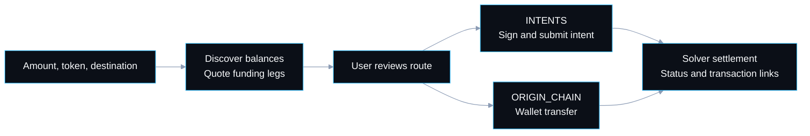

Man0’s **Fund / Swap** flow converts a natural-language transfer request into an Intents route. The backend discovers supported chains and tokens, reads available balances and prepares the exact-input quote.

| Network | Route service |
| --- | --- |
| Mainnet | OneClick at `https://1click.chaindefuser.com`, with verifier `intents.near` |
| Testnet | Tidepool at `https://www.usetidepool.tech`, using its health and token discovery |

The request can express an amount in token units, dollars or the available maximum. It can deposit into the Man0 wallet, swap into a chosen token, or withdraw to a destination address.

## Route selection

Man0 reads token metadata and scans connected wallet holdings concurrently. It can assemble up to **six funding legs** for a request. Each leg records its source wallet, source and destination tokens, recipient, amount, quote and deposit instructions.

Quotes use **EXACT_INPUT**, **1% slippage tolerance** and a **30-minute deadline**. Deposit instructions support **SIMPLE** and **MEMO** routes; the client preserves the memo when the route requires one.

## Two funding paths

For an `INTENTS` source, the backend generates the swap-transfer intent, signs it with the account’s registered P-256 owner in WebAuthn format, and submits it to the route service.

For an `ORIGIN_CHAIN` source, the origin wallet sends the native token or token transfer to the quoted deposit address. The client reports the transaction hash so the route service can follow the deposit and settlement.

See [Intents integration](/near/intents-integration) for client calls, wallet signing and status handling.
