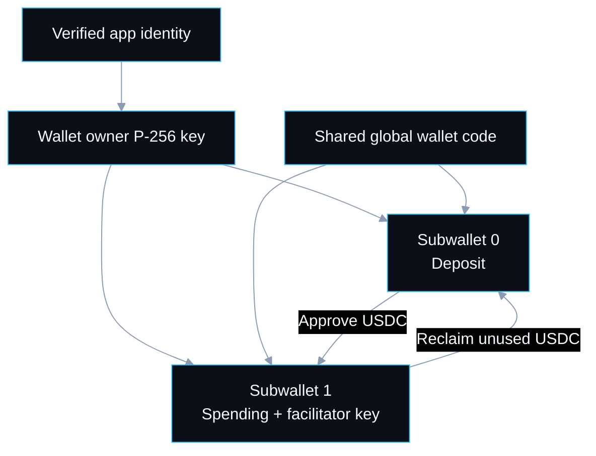

A Man0 identity maps to a P-256 wallet owner and two Universal Account initializations. Both use the same global wallet contract code, while their state, balances and access keys belong to separate accounts.

| Subwallet | Role |
| --- | --- |
| `0` | Deposit wallet, used for account funds and user contract calls |
| `1` | Spending wallet, used for authorized workflow payments |

The spending initialization includes the facilitator’s Ed25519 access key. Approving a spending amount transfers USDC into that wallet; reclaiming returns unused USDC to the deposit wallet.

## Address derivation

Man0 serializes wallet state with the compressed P-256 owner key, subwallet ID, timeout, extension state and nonce state. It then wraps that state with the global contract identifier and access keys in Borsh `UniversalStateInit` bytes.

```text
wallet address = "0u" + CrockfordBase32(SHA3-256(UniversalStateInit))
```

Global code can be identified by an account ID or a 32-byte code hash. Extension names and access keys have a deterministic order, so the same initialization produces the same address.

## Provisioning



The backend derives the address before deploying it, checks existing account/code state and verifies the wallet’s `w_public_key`. Provisioning can use NEAR’s native `UniversalStateInit` transaction action, discriminant **15**, alongside the funding actions needed for initialization.

Token preparation registers storage where required. Intents preparation also registers the wallet’s supported public key with the verifier. See [relayed execution](/near/execution) for signed requests and [Session](/app/session) for the user-facing spending controls.
