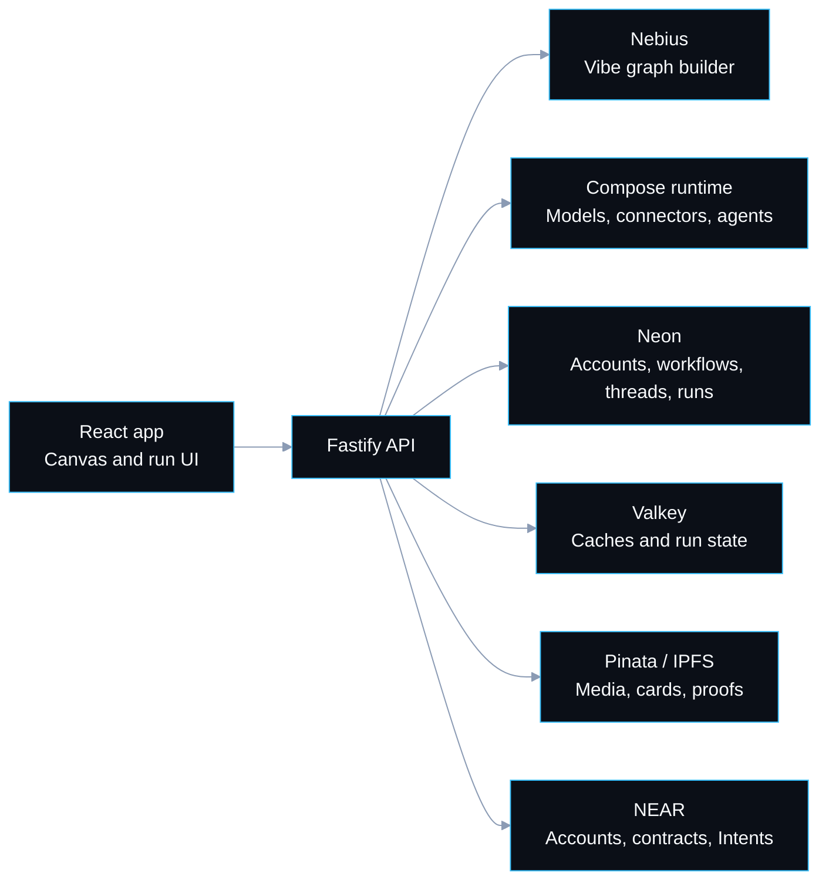

The React app edits workflows and displays streamed execution. A Fastify API validates requests, manages account and workflow state, and connects the app to model inference, Compose and NEAR.

| Component | Responsibility |
| --- | --- |
| React, TypeScript and Vite | App rendering and local development/build tooling |
| React Flow | Canvas nodes, edges, handles, viewport and graph interaction |
| AG Grid / AG Charts Community | Creator workflow tables, activity and charts |
| Fastify / Zod | HTTP routes, request validation, access checks and NDJSON streams |
| Compose SDK | Catalog discovery, coordinator execution, resource calls, sessions, metering and payment settlement |
| Nebius chat completions | Vibe’s tool-driven graph building |
| Google image generation | Avatars and workflow banners |
| Neon / Drizzle | Durable relational account, workflow and run records |
| Valkey / ioredis | Shared caches and frequently updated composer state |
| Pinata / IPFS | Addressed media files, workflow cards and proof bundles |
| NEAR APIs and Intents SDKs | Universal Account provisioning, relayed calls and cross-chain routes |
| Cloud Run | Containerized Node.js API hosting and HTTP concurrency |

Inference runs through hosted services and the resources selected in the catalog. [Performance](/workflows/performance) covers streaming, caching and concurrency; [NEAR](/near/overview) covers the account and contract layer.
